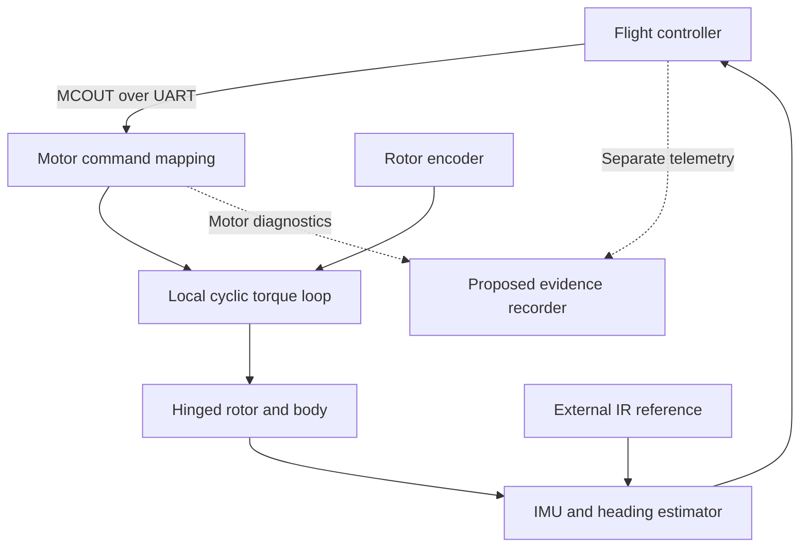

# Baseline assessment

**Reviewed on 27 October 2026 UTC.** Evidence labels follow the [research guide](README.md). This assessment uses immutable source references where possible. It does not certify an assembled aircraft.

## 1. What has actually been forked

The development repository is [k2jac9/single-propeller-drone](https://github.com/k2jac9/single-propeller-drone), forked from Joshua Bird's [original CAD repository](https://github.com/jyjblrd/single-propeller-drone). At inspection, both `main` branches resolve to `efc9176bfc83777b870b967c1f62a686c099be2c`, whose tree is `bbdc527501febc4b549cd43ea8c644466f206cd5`. The six-commit original history changes documentation and media after the initial CAD release. The CAD tree contains body, prop plate and two propeller variants in Fusion/STEP formats. [Pinned tree](https://github.com/jyjblrd/single-propeller-drone/tree/efc9176bfc83777b870b967c1f62a686c099be2c); [network evidence](02-fork-network.md).

The flight stack is external to this repository. The original README links two independently versioned forks:

| Component | Observed default branch and commit | Role |
|---|---|---|
| CAD and project entry point | `main` / `efc9176bfc83777b870b967c1f62a686c099be2c` | Geometry, media and firmware links |
| `jyjblrd/ardupilot` | `master` / `455b266cc2a73505eb98c56a8049fa6a4d50f9bf` | Attitude control, MCOUT command generation and IR-assisted heading |
| `jyjblrd/moteus` | `main` / `704a0dd9f30a3704e8915a82c1631301fdbff9bd` | MCOUT reception, command gating and rotor-synchronous torque modulation |

These are **observed source snapshots**, not a demonstrated compatible build set. The saved ArduPilot parameter export identifies an older firmware version; protocol enumeration changed between that export and current source. A reproducible release needs firmware binaries, build identifiers, board identities, parameter exports and assembly records, not just these three repository URLs. [Firmware audit](03-firmware-audit.md).

## 2. How one motor provides useful control

The author's explanation describes a passive hinged propeller: motor acceleration creates blade lag, which changes the two blades' pitch in complementary directions. Torque modulation at selected rotor angles produces a cyclic response. The reported printed hub material is PPA-CF and the reported operating speed approaches 20,000 RPM. These are first-person reports; this review did not measure the aircraft or retrieve the full explanatory video. [Author's explanation](https://www.reddit.com/r/robotics/comments/1x8zyvp/i_built_a_drone_with_only_one_motor_and_a_poor/).

The implementation separates two rotations. The motor encoder measures fast rotor azimuth relative to the aircraft. The flight controller estimates slower body orientation relative to the world. The IR heading mechanism propagates heading with gyro data and corrects it when an external beacon is observed. A heading reference does not provide independent yaw actuation, and rotor azimuth does not provide world heading. [IR implementation guide](https://github.com/jyjblrd/ardupilot/blob/455b266cc2a73505eb98c56a8049fa6a4d50f9bf/libraries/AP_IRBeaconYaw/README.md).

The current one-way MCOUT connection carries roll, pitch, yaw, throttle, control decomposition and state fields in a packed binary message. The motor mapping uses roll/pitch magnitude and angle to determine cyclic amplitude and phase; the transmitted yaw field is not an independent yaw actuator. Default throttle mapping targets rotor velocity. The high-frequency sine is generated locally against rotor angle, so the UART command rate is not the torque-modulation sample rate. [Motor mapping](https://github.com/jyjblrd/moteus/blob/704a0dd9f30a3704e8915a82c1631301fdbff9bd/fw/flight_control_structs.h); [local control code](https://github.com/jyjblrd/moteus/blob/704a0dd9f30a3704e8915a82c1631301fdbff9bd/fw/bldc_servo_control.h).

## 3. Integration issues that affect the next step

### Source and configuration identity

Current ArduPilot source assigns MCOUT serial protocol **51**, while an older saved parameter export and the moteus guide use **50**. In the inspected current enum, 50 is IOMCU. This is a versioned configuration compatibility issue. Copying the historical export into a current build without reconciling the enum is not a reproducible setup procedure. [Current enum](https://github.com/jyjblrd/ardupilot/blob/455b266cc2a73505eb98c56a8049fa6a4d50f9bf/libraries/AP_SerialManager/AP_SerialManager.h); [export](https://github.com/jyjblrd/ardupilot/blob/455b266cc2a73505eb98c56a8049fa6a4d50f9bf/configs/mcout-working.params); [moteus guide](https://github.com/jyjblrd/moteus/blob/704a0dd9f30a3704e8915a82c1631301fdbff9bd/docs/guides/ardupilot-mcout.md).

### Requested versus delivered command rate

MCOUT is 84 bytes. Under 8N1 UART framing, each byte costs ten wire bits. The saved 190 Hz request would require `84 × 10 × 190 = 159,600 bit/s`, exceeding a 115,200-baud link's theoretical packet ceiling of approximately 137.14 Hz.

However, the same export sets a 400 Hz scheduler. In the inspected sender, a successful timing decision resets the last-send time to the current loop time. With an ideal 2.5 ms loop, a requested period of approximately 5.263 ms is first reached after three loops, producing approximately **133.3 Hz**, or **112,000 bit/s** before other effects. That can fit 115,200 baud. Thus the evidence establishes an unattainable requested rate and a potentially important scheduler dependency, **not a confirmed sustained overload in the saved setup**. Real scheduler jitter, buffering and transmit-space skips still need measurement. [Sender timing and transmit-space check](https://github.com/jyjblrd/ardupilot/blob/455b266cc2a73505eb98c56a8049fa6a4d50f9bf/libraries/AP_MotorControlOutput/AP_MotorControlOutput.cpp).

### Command freshness and re-engagement

The moteus logic checks freshness and configured state flags, and has stop/watchdog behavior. Its fault-clear path is based on becoming eligible while not engaged and the servo being faulted; it is not an explicit requirement for a new operator arm transition. A link recovery with armed flags still present can therefore interact with fault clearing and re-engagement. Treat this as a source-derived behavior to specify and exercise deliberately, not a reported incident. The historical export also disables particular ArduPilot failsafes; its choices should not silently become a new build's defaults. [Logic and tests](https://github.com/jyjblrd/moteus/blob/704a0dd9f30a3704e8915a82c1631301fdbff9bd/fw/flight_control_structs.h); [detailed audit](03-firmware-audit.md).

### Phase, saturation and heading

The baseline mapping uses a constant cyclic phase offset. A community PR adds optional speed-scheduled phase advance, but supplies no rotor calibration or flight measurements. One-way MCOUT also does not return actuator saturation to the flight controller. Those two limitations motivate measured phase identification and correlated motor/autopilot diagnostics. A fixed beacon bearing can change when the aircraft translates, so the current IR assumption needs a defined geometry and operating envelope before navigation experiments. [Phase PR](https://github.com/jyjblrd/moteus/pull/1); [IR guide](https://github.com/jyjblrd/ardupilot/blob/455b266cc2a73505eb98c56a8049fa6a4d50f9bf/libraries/AP_IRBeaconYaw/README.md).

## 4. What remains unknown

| Missing evidence | Why it changes development decisions | First useful artifact |
|---|---|---|
| Exact motor, controller revision, encoder, flight controller, wiring and power system | Determines current, voltage, sensing and timing constraints | Versioned BOM and annotated wiring record |
| Printed process, assembly dimensions, balance and hinge friction | Changes cyclic response, vibration and repeatability | Assembly traveler and specimen ID |
| Mass, center of mass, inertia and actual RPM range | Required for a meaningful dynamics model and payload decision | Measured mass properties with uncertainty |
| Force/moment gain, phase, delay and saturation | Determines whether a controller improvement is physically available | Synchronized identification dataset |
| Delivered command rate, clock mapping and fault/recovery traces | Distinguishes transport/estimation defects from control defects | Raw captures plus timing provenance |
| Matched-lift electrical power and repeatability | Tests the proposed efficiency benefit | Controlled comparison with raw voltage/current data |
| Fatigue, wear, temperature and conditioning response | Determines the demonstrated construction envelope | Cycle-indexed specimen inspection and endurance data |
| Independent position/heading accuracy under spin and translation | Determines whether navigation feedback is trustworthy | Reference trajectories and estimator error report |

No numeric endurance, payload, wind tolerance or service-life target is inferred from a video or CAD filename. The two propeller variants are candidate geometries; version numbering alone is not proof of better performance. [Pinned CAD tree](https://github.com/jyjblrd/single-propeller-drone/tree/efc9176bfc83777b870b967c1f62a686c099be2c); [hardware evidence and proposed measurements](04-control-and-hardware-research.md).

## 5. Reuse and provenance

The inspected CAD tree contains no license file and GitHub reports no detected license. The author's public release and use of the term open source should not be substituted for recorded permissions. ArduPilot and moteus have their own licenses and histories; new documentation must not purport to relicense inherited CAD or firmware. Before a redistributed release, record component permissions and attribution alongside the source/build manifest. [Network/license observations](02-fork-network.md); [GitHub's licensing explanation](https://docs.github.com/en/repositories/managing-your-repositorys-settings-and-features/customizing-your-repository/licensing-a-repository).

The immediate value of this fork is to supply the missing reproducibility layer. The [roadmap](../plans/2026-10-26-evolution-roadmap.md) makes that layer a prerequisite for larger control, mechanical or autonomy changes.
